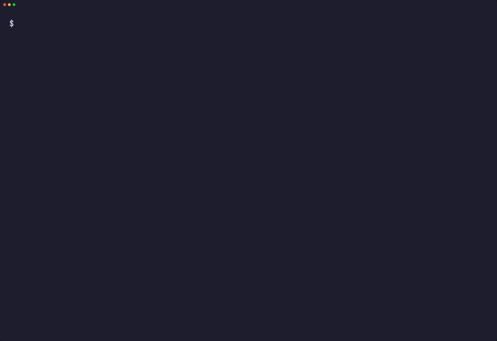
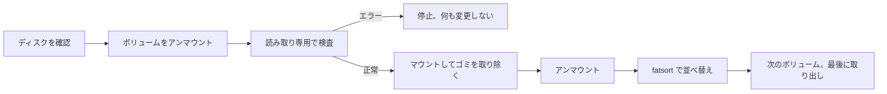
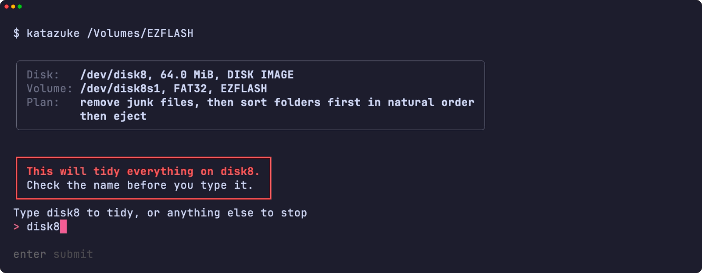
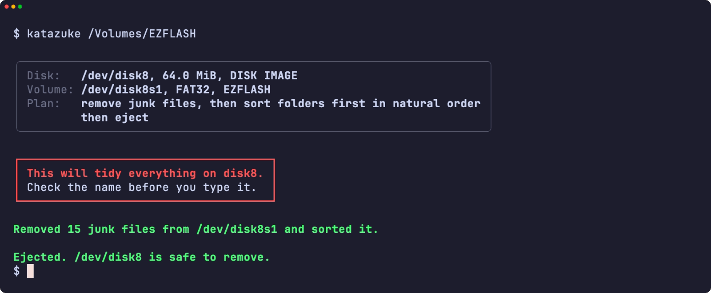
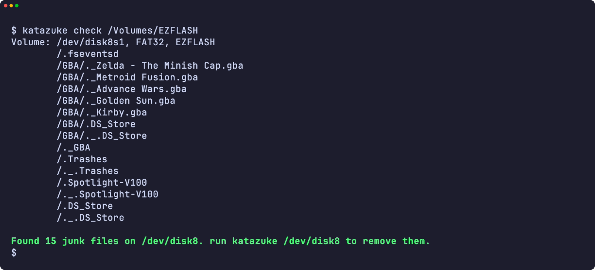
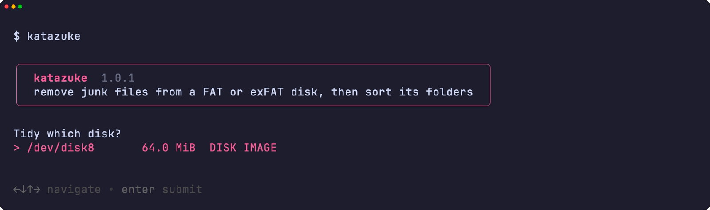
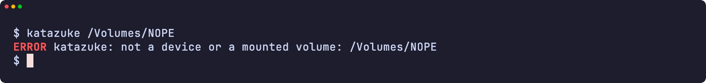
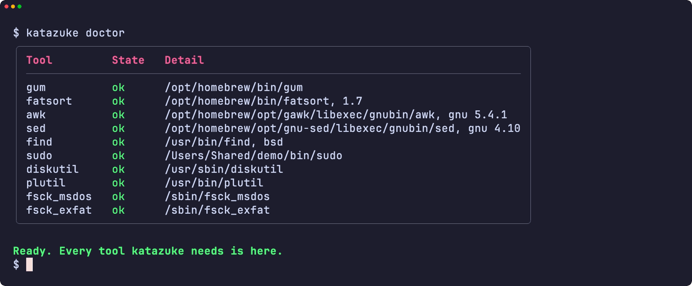
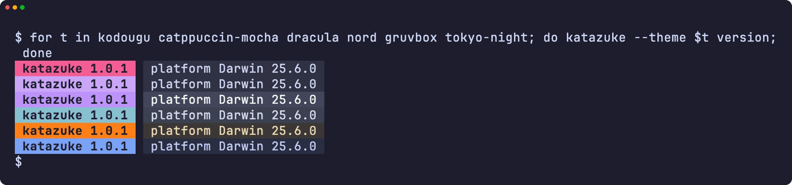
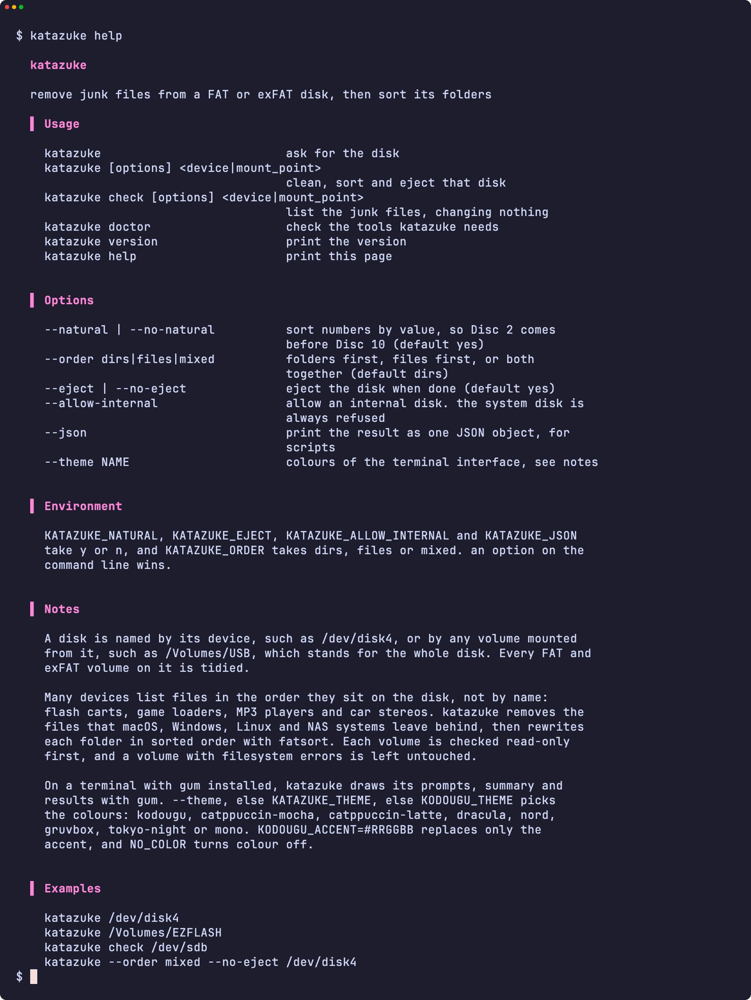

<div align="center">

<h1>katazuke</h1>

<strong>macOS、Windows、NAS が FAT や exFAT のディスクに残すゴミファイルを取り除き、ディスク上の順番でファイルを並べる機器のためにフォルダを並べ替えます。</strong>

[English](README.md) | 日本語 | [简体中文](README.zh-Hans.md) | [繁體中文 (香港)](README.zh-HK.md)

[](https://github.com/gufranco/katazuke/actions/workflows/ci.yml)
[](https://github.com/gufranco/katazuke/releases/latest)
[](LICENSE)

<p align="center">
  <a href="#quick-start"><strong>クイックスタート</strong></a> |
  <a href="#what-it-removes">取り除くもの</a> |
  <a href="#development">開発</a>
</p>

</div>

コマンドは 1 つ、テストは 160 個、シェルモジュールは 6 つ。POSIX システム以外に必要なのは fatsort と gum だけです。`katazuke` は日本語の「片付け」です。姉妹ツールの [kakikomi](https://github.com/gufranco/kakikomi) はディスクイメージを書き込み、[kiyome](https://github.com/gufranco/kiyome) はディスクを消去します。

---

<p align="center">
  
</p>

```console
$ katazuke check /Volumes/EZFLASH
Volume: /dev/disk8, FAT32, EZFLASH
        /.fseventsd
        /._Mario Kart 10.gba
        /._Mario Kart 2.gba
        /._Metroid Fusion.gba
        /SAVER/Thumbs.db
        /SAVER/._Thumbs.db
        /._SAVER
Found 7 junk files on /dev/disk8. run katazuke /dev/disk8 to remove them.

$ katazuke /dev/disk8

Disk:   /dev/disk8, 63.0 MiB, DISK IMAGE
Volume: /dev/disk8, FAT32, EZFLASH
Plan:   remove junk files, then sort folders first in natural order
        then eject

Type disk8 to tidy, or anything else to stop: disk8
Removed 7 junk files from /dev/disk8 and sorted it.
Ejected. /dev/disk8 is safe to remove.
```

<a id="quick-start"></a>

## クイックスタート

### 前提条件

| ツール | 用途 | インストール |
|:-------|:-----|:-------------|
| [`gum`](https://github.com/charmbracelet/gum) | 端末の画面：メニュー、入力、表、配色 | `brew install gum`。Homebrewのformulaが自動でインストールします |
| POSIX `sh`、`awk`、`sed`、`find` | ツール本体 | macOS と Linux に標準で入っています。`bash` は不要です |
| `fatsort` | 各フォルダを並べ替えて書き直します。1.7 以降はすべての exFAT ボリュームを並べ替えられます。Ubuntu 26.04 の 1.6.5 は `mkfs.exfat` でフォーマットしたものを並べ替えられません | `brew install fatsort`、`apt install fatsort` |
| `fsck_msdos`、`fsck_exfat` | macOS で、変更前に読み取り専用で検査します | 標準で入っています |
| `fsck.vfat`、`fsck.exfat` | Linux で同じ検査をします | `apt install dosfstools exfatprogs` |

### インストール

```bash
brew install gufranco/tap/katazuke
```

ソースからもインストールできます。

```bash
git clone https://github.com/gufranco/katazuke.git
cd katazuke
make install
```

`make install` はツール、man ページ、bash・zsh・fish の補完を `~/.local` にコピーし、`katazuke` を `~/.local/bin` に置きます。場所を変えるには `PREFIX` を指定します。Homebrew の formula は同じファイルと fatsort をインストールします。

### 確認

```console
$ katazuke doctor
gum                ok       /opt/homebrew/bin/gum
fatsort            ok       /opt/homebrew/bin/fatsort
awk                ok       /opt/homebrew/opt/gawk/libexec/gnubin/awk, gnu 5.4.1
sed                ok       /opt/homebrew/opt/gnu-sed/libexec/gnubin/sed, gnu 4.10
find               ok       /usr/bin/find, bsd
sudo               ok       /usr/bin/sudo
diskutil           ok       /usr/sbin/diskutil
plutil             ok       /usr/bin/plutil
fsck_msdos         ok       /sbin/fsck_msdos
fsck_exfat         ok       /sbin/fsck_exfat
```

## 使い方

| コマンド | 目的 |
|:---------|:-----|
| `katazuke [options] <device\|mount_point>` | そのディスク上のすべての FAT・exFAT ボリュームからゴミを取り除き、並べ替えてから、ディスクを取り出します |
| `katazuke check <device\|mount_point>` | 各ボリュームのゴミを一覧にします。何も変更しません |
| 引数なしの `katazuke` | ターミナルで実行すると、対象のディスクを尋ねます |
| `katazuke doctor` | katazuke に必要なツールと、それぞれが入っているかを表示します |
| `katazuke version`、`katazuke help` | バージョン、または使い方の全文を表示します |

| オプション | 効果 |
|:-----------|:-----|
| `--natural`、`--no-natural` | 数字を値で並べるので、`Disc 2` が `Disc 10` より前に来ます。既定でオンです |
| `--order dirs\|files\|mixed` | フォルダを先に、ファイルを先に、または両方をまとめて並べます。既定は `dirs` です |
| `--eject`、`--no-eject` | 終わったらディスクを取り出します。既定でオンです |
| `--allow-internal` | 内蔵ディスクを許可します。起動中のシステムがあるディスクは常に拒否されます |
| `--json` | 結果をスクリプト向けに 1 つの JSON オブジェクトで表示します |
| `--theme <name>` | 端末の画面の配色 |

`--order=mixed` の形も使え、`--` でオプションが終わります。環境変数 `KATAZUKE_NATURAL`、`KATAZUKE_EJECT`、`KATAZUKE_ALLOW_INTERNAL`、`KATAZUKE_JSON` に `y` か `n` を、`KATAZUKE_ORDER` に値を設定すると、同じオプションになります。コマンドラインのオプションが優先されます。

```bash
katazuke /dev/disk4                     # 片付け、フォルダを先に並べ替え、取り出し
katazuke /Volumes/EZFLASH               # マウント中のボリュームはそのディスク全体を指します
katazuke check /dev/sdb                 # ゴミを一覧にするだけで、何も変えません
katazuke --order mixed --no-eject /dev/disk4
```

ディスクは `/dev/disk4` のようなデバイス、または `/Volumes/USB` のようにそこからマウントされた任意のボリュームで指定します。katazuke はボリュームの後ろにあるディスク全体を求め、その上のすべての FAT・exFAT ボリュームを片付けます。

**パーティションを 1 つ指定しても、そのディスク全体が対象です。** `katazuke /dev/disk8s2` は 2 番目のパーティションだけでなく、`/dev/disk8` 上のすべての FAT・exFAT ボリュームを片付けます。確認の前に要約が各ボリュームを示し、1 回の確認ですべてに適用されます。APFS や ext4 など、ディスク上のほかのファイルシステムには触れません。ボリュームは順に片付けられ、検査に失敗したボリュームがあるとそこで止まります。それより前のボリュームは片付いたまま、後のボリュームは手つかずのままです。

katazuke はファミリー共通のコマンドライン規約に従います。内容は [FAMILY.md](FAMILY.md) にあります。

### テーマ

`gum`がインストールされた端末では、katazukeはメニュー、入力、表、メッセージをgumで描きます。パイプやスクリプトでは、出力はプレーンテキストのままです。配色は`--theme`、なければ`KATAZUKE_THEME`、なければ`KODOUGU_THEME`で選びます。最後のものはkodouguのすべてのツールが共有します：`kodougu` （既定）、`catppuccin-mocha`、`catppuccin-latte`、`dracula`、`nord`、`gruvbox`、`tokyo-night`、`mono`。`KODOUGU_ACCENT=#RRGGBB`はアクセント色だけを置き換え、`NO_COLOR`は色を消します。

```bash
export KODOUGU_THEME=catppuccin-mocha
```

<a id="what-it-removes"></a>

## 取り除くもの

フラッシュカート、ゲームローダー、MP3 プレーヤー、カーステレオは、ファイルをディスク上に並んでいる順に表示することがよくあります。そのため Mac からコピーしたフォルダではすべてのファイルに `._` の双子が付き、少しずつ増やしたフォルダでは書き込んだ順に項目が並びます。katazuke は前者を取り除き、後者を直します。

| 場所 | 名前 |
|:-----|:-----|
| ボリュームの最上位だけ | `System Volume Information`、`$RECYCLE.BIN`、`RECYCLER`、`RECYCLED`、`.Trashes`、`.Spotlight-V100`、`.fseventsd`、`.TemporaryItems`、`.DocumentRevisions-V100`、`.MobileBackups`、`.apdisk`、`.VolumeIcon.icns`、`.metadata_never_index`、`.com.apple.timemachine.*`、`Network Trash Folder`、`Temporary Items`、`TheFindByContentFolder`、`TheVolumeSettingsFolder`、`IndexerVolumeGuid`、`WPSettings.dat`、`FSCK*.REC`、`FOUND.000`、`.Trash-*`、`@eaDir`、`#recycle`、`@Recycle`、`.hotfiles.btree`、`.journal`、`.journal_info_block` |
| すべてのフォルダ | `._*`、`.DS_Store`、`.AppleDouble`、`.AppleDB`、`.AppleDesktop`、`__MACOSX`、`Icon\r`、`Thumbs.db`、`ehthumbs.db`、`ehthumbs_vista.db`、`Desktop.ini`、`.directory`、`.~lock.*`、`~$*`、`.@__thumb`、`.dropbox`、`.dropbox.attr` |

ボリュームの最上位より下にある `System Volume Information` という名前のフォルダはあなたのデータなので残します。DOS や Windows のゲームディスクで必要になることがあるため、`autorun.inf` と `DumpStack.log` は決して取り除きません。名前は大文字と小文字を区別せずに照合します。

<a id="how-it-works"></a>

## 仕組み



各ボリュームは、何かを変える前に、macOS では `fsck_msdos -n` か `fsck_exfat -n`、Linux では `fsck.vfat -n` か `fsck.exfat -n` で検査します。壊れたファイルシステムでディレクトリを書き直すと損傷が広がることがあるため、ファイルシステムにエラーがあるボリュームでは何も変えずに停止します。

katazuke は `.fseventsd/no_log` を決して書きません。FAT ディスクでは新しい項目が 4 つ残り、それがまさに機器に表示されてしまうからです。マウントしたまま片付けてからアンマウントすれば、ディスクはきれいなままです。

`check` はマウントされていないボリュームを読み取り専用でマウントするので macOS は書き込めません。終わるとアンマウントし直します。

自然順はバイト単位で名前を比べるため、`Ábaco` や `ゼルダ` のようにアクセント付きの文字や非ラテン文字で始まる名前は、A から Z の名前の間には並びません。macOS ではそれらがすべての A から Z の名前より前に、Linux arm64 では後に来ます。`--no-natural` ではどちらのシステムでもすべての A から Z の名前の後に来て、`Disc 10` が `Disc 2` より前になります。

<a id="portability"></a>

## 移植性

すべて POSIX `sh` で書かれ、ShellCheck `-o all` の指摘はゼロです。テストは macOS では `/bin/sh` と `dash`、システムの bash 3.2 と zsh、Homebrew の最新の bash と zsh で、Ubuntu では特権コンテナ内の `dash`、`bash`、`bash --posix`、`zsh` で実行します。

よく使われる 6 つのツールセットすべてで動きます。GNU、uutils、BusyBox のツールを使う Linux と、macOS 付属のツール、その新しい Homebrew 版、Homebrew の uutils 版を使う macOS です。`katazuke doctor` は `awk`、`sed`、`find` の種類とバージョンを `gnu 4.10.0`、`uutils 0.8.0`、`bsd 20200816` のように示すので、バグ報告からどのツールが動いたかがわかります。

<a id="screens"></a>

## 画面

<details>
<summary><code>make screens</code> で実際の実行から録画したすべての画面</summary>
<br>

<table>
<tr>
<td width="50%" valign="top"><br><sub>危険ボックスの下での名前の入力</sub></td>
<td width="50%" valign="top"><br><sub>結果</sub></td>
</tr>
<tr>
<td width="50%" valign="top"><br><sub>check は何も変えずに不要なファイルを一覧表示</sub></td>
<td width="50%" valign="top"><br><sub>ディスクの選択</sub></td>
</tr>
<tr>
<td width="50%" valign="top"><br><sub>エラー</sub></td>
<td width="50%" valign="top"><br><sub>doctor が必要なツールをすべて確認</sub></td>
</tr>
<tr>
<td width="50%" valign="top"><br><sub>6 つのテーマでのバージョン表示</sub></td>
<td width="50%" valign="top"><br><sub>ヘルプ</sub></td>
</tr>
</table>

</details>

<a id="development"></a>

## 開発

| コマンド | 説明 |
|:---------|:-----|
| `make fmt` | すべてのスクリプトを shfmt で整形します |
| `make lint` | shfmt、すべてのスクリプト・テスト・補完への ShellCheck、名前の検査、man ページへの mandoc |
| `make test` | システムの `sh` で `bats` テストを実行します |
| `make test-all` | すべてのシェルで同じテストを実行します。macOS では bash と zsh の両方のビルドを含みます |
| `make test-linux` | Ubuntu コンテナで同じテストを実行します |
| `make coverage` | この Mac と Ubuntu コンテナでの bashcov 行カバレッジを統合し、CI と同じ 100% のゲートをかけます |
| `make screens` | macOS で、README の画面を実物のツールから VHS で録画します |

テストは本物の FAT12、FAT16、FAT32、exFAT のディスクイメージを作り、`hdiutil` か `losetup` で接続して、実際に片付けます。CI は Ubuntu と macOS で実行します。`main` への push で CI が通ると semantic-release が動き、`feat` か `fix` のコミットがリリースを公開して、[`lib/core.sh`](lib/core.sh) の `KATAZUKE_VERSION` と CHANGELOG を更新し、Homebrew の formula を上げます。

## ライセンス

[MIT](LICENSE)
