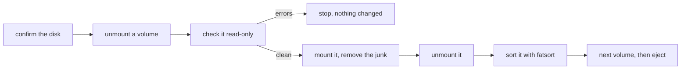
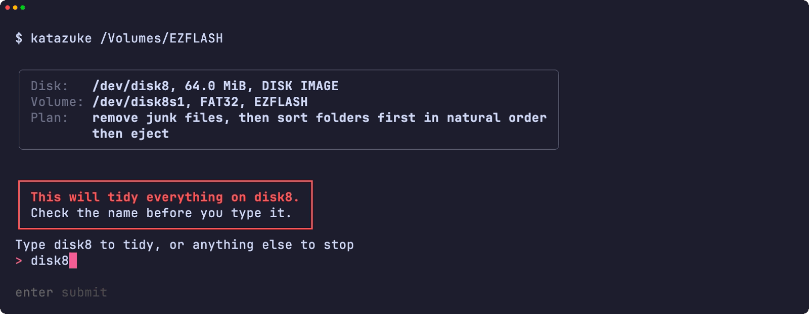
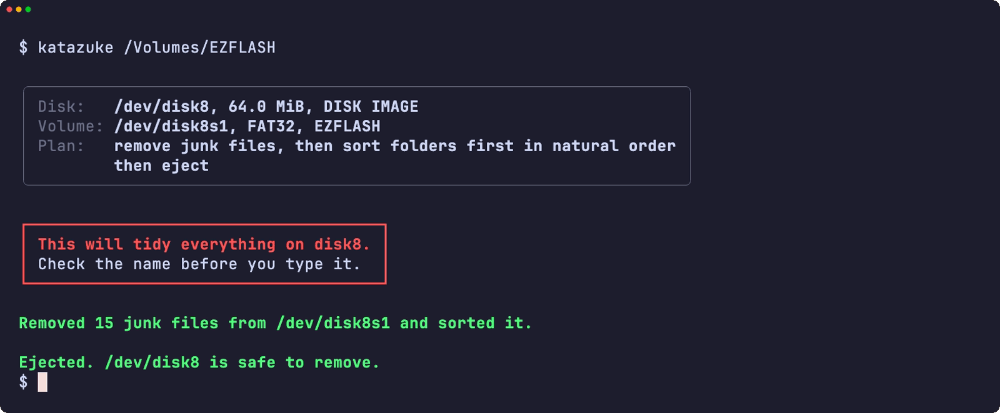
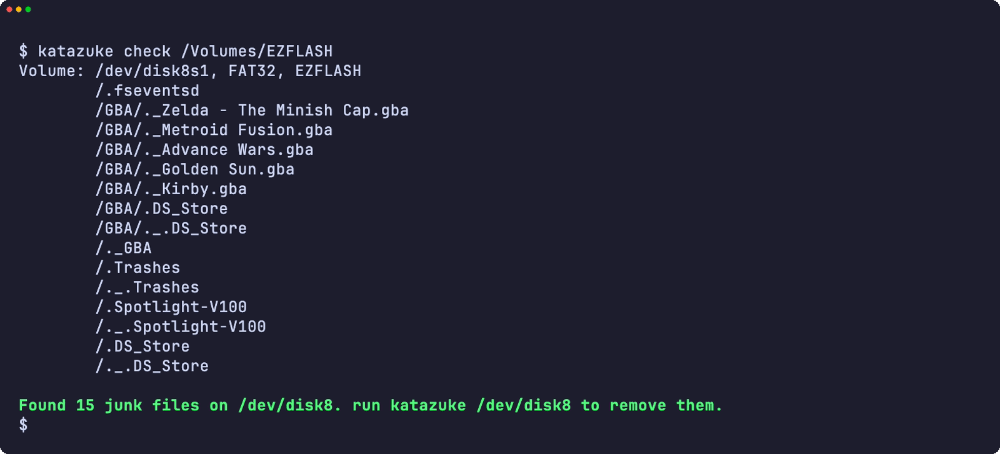
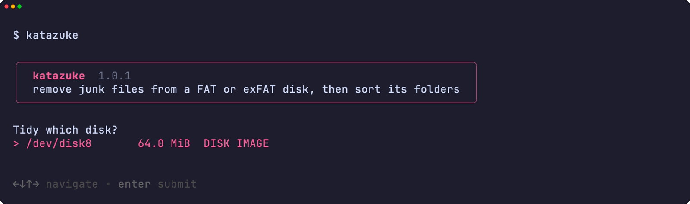
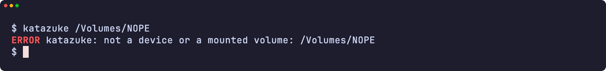
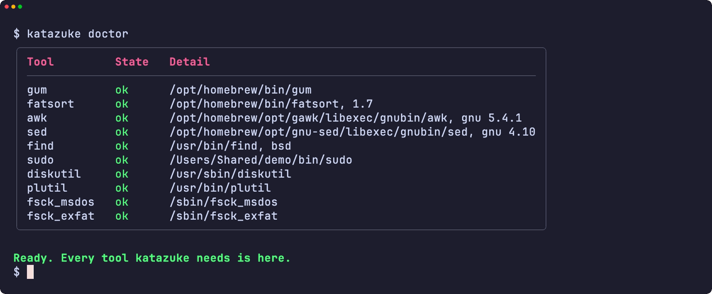
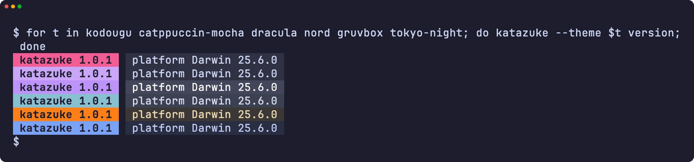
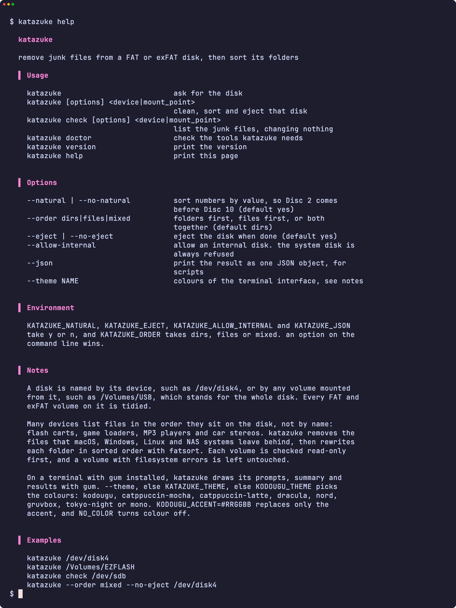

<div align="center">

<h1>katazuke</h1>

<strong>Clear the junk that macOS, Windows and NAS systems leave on a FAT or exFAT disk, then sort its folders for devices that list files in disk order.</strong>

English | [日本語](README.ja.md) | [简体中文](README.zh-Hans.md) | [繁體中文 (香港)](README.zh-HK.md)

[](https://github.com/gufranco/katazuke/actions/workflows/ci.yml)
[](https://github.com/gufranco/katazuke/releases/latest)
[](LICENSE)

<p align="center">
  <a href="#quick-start"><strong>Quick start</strong></a> |
  <a href="#what-it-removes">What it removes</a> |
  <a href="#development">Development</a>
</p>

</div>

One command, 160 tests, 6 shell modules, and two dependencies beyond a POSIX system: fatsort and gum. `katazuke` is 片付け, Japanese for tidying up. Its companions [kakikomi](https://github.com/gufranco/kakikomi) writes disk images and [kiyome](https://github.com/gufranco/kiyome) wipes disks.

---

<p align="center">
  
</p>

```console
$ katazuke check /Volumes/EZFLASH
Volume: /dev/disk8, FAT32, EZFLASH
        /.fseventsd
        /._Mario Kart 10.gba
        /._Mario Kart 2.gba
        /._Metroid Fusion.gba
        /SAVER/Thumbs.db
        /SAVER/._Thumbs.db
        /._SAVER
Found 7 junk files on /dev/disk8. run katazuke /dev/disk8 to remove them.

$ katazuke /dev/disk8

Disk:   /dev/disk8, 63.0 MiB, DISK IMAGE
Volume: /dev/disk8, FAT32, EZFLASH
Plan:   remove junk files, then sort folders first in natural order
        then eject

Type disk8 to tidy, or anything else to stop: disk8
Removed 7 junk files from /dev/disk8 and sorted it.
Ejected. /dev/disk8 is safe to remove.
```

<a id="quick-start"></a>

## Quick start

### Prerequisites

| Tool | Why | Install |
|:-----|:----|:--------|
| [`gum`](https://github.com/charmbracelet/gum) | The terminal interface: menus, prompts, tables and colours | `brew install gum`. Installed automatically by the Homebrew formula |
| POSIX `sh`, `awk`, `sed`, `find` | The tool itself | Preinstalled on macOS and Linux. `bash` is not required |
| `fatsort` | Rewrites each folder in sorted order. 1.7 or later sorts every exFAT volume; Ubuntu 26.04 ships 1.6.5, which cannot sort one formatted by `mkfs.exfat` | `brew install fatsort`; `apt install fatsort` |
| `fsck_msdos`, `fsck_exfat` | The read-only check before any change, on macOS | Preinstalled |
| `fsck.vfat`, `fsck.exfat` | The same check on Linux | `apt install dosfstools exfatprogs` |

### Install

```bash
brew install gufranco/tap/katazuke
```

Or from source:

```bash
git clone https://github.com/gufranco/katazuke.git
cd katazuke
make install
```

`make install` copies the tool, its man page and its bash, zsh and fish completions under `~/.local`, and puts `katazuke` in `~/.local/bin`; set `PREFIX` to change that. The Homebrew formula installs the same files and fatsort.

### Verify

```console
$ katazuke doctor
gum                ok       /opt/homebrew/bin/gum
fatsort            ok       /opt/homebrew/bin/fatsort
awk                ok       /opt/homebrew/opt/gawk/libexec/gnubin/awk, gnu 5.4.1
sed                ok       /opt/homebrew/opt/gnu-sed/libexec/gnubin/sed, gnu 4.10
find               ok       /usr/bin/find, bsd
sudo               ok       /usr/bin/sudo
diskutil           ok       /usr/sbin/diskutil
plutil             ok       /usr/bin/plutil
fsck_msdos         ok       /sbin/fsck_msdos
fsck_exfat         ok       /sbin/fsck_exfat
```

## Usage

| Command | Purpose |
|:--------|:--------|
| `katazuke [options] <device\|mount_point>` | Remove the junk from every FAT and exFAT volume on that disk, sort each one, then eject the disk |
| `katazuke check <device\|mount_point>` | List the junk on every volume, changing nothing |
| `katazuke` with no arguments | Ask for the disk when run in a terminal |
| `katazuke doctor` | List the tools katazuke needs and whether they are installed |
| `katazuke version`, `katazuke help` | Print the version or the full usage page |

| Option | Effect |
|:-------|:-------|
| `--natural`, `--no-natural` | Sort numbers by value, so `Disc 2` comes before `Disc 10`. On by default |
| `--order dirs\|files\|mixed` | Folders first, files first, or both together. `dirs` by default |
| `--eject`, `--no-eject` | Eject the disk when done. On by default |
| `--allow-internal` | Allow an internal disk. The disk holding the running system is always refused |
| `--json` | Print the result as one JSON object, for scripts |
| `--theme <name>` | Colours of the terminal interface |

`--order=mixed` works too, and `--` ends the options. The environment variables `KATAZUKE_NATURAL`, `KATAZUKE_EJECT`, `KATAZUKE_ALLOW_INTERNAL` and `KATAZUKE_JSON`, each `y` or `n`, and `KATAZUKE_ORDER` set the same options; an option on the command line wins.

```bash
katazuke /dev/disk4                     # clean, sort folders first, eject
katazuke /Volumes/EZFLASH               # a mounted volume stands for its whole disk
katazuke check /dev/sdb                 # list the junk, change nothing
katazuke --order mixed --no-eject /dev/disk4
```

A disk is named by its device, such as `/dev/disk4`, or by any volume mounted from it, such as `/Volumes/USB`; katazuke works out the whole disk behind the volume and tidies every FAT and exFAT volume on it.

**One partition stands for its whole disk too.** `katazuke /dev/disk8s2` tidies every FAT and exFAT volume on `/dev/disk8`, not only the second partition. The summary lists each volume before you confirm, and one confirmation covers them all. Other filesystems on the disk, such as APFS or ext4, are left alone. Volumes are tidied in order, and a volume that fails its check stops the run: the ones before it stay tidied and the ones after it are untouched.

katazuke follows the shared command-line contract of its family, described in [FAMILY.md](FAMILY.md).

### Themes

On a terminal with `gum` installed, katazuke draws its menus, prompts, tables and messages with gum; in a pipe or a script the output stays plain text. `--theme`, else `KATAZUKE_THEME`, else `KODOUGU_THEME` picks the colours, the last one shared by every kodougu tool: `kodougu` (default), `catppuccin-mocha`, `catppuccin-latte`, `dracula`, `nord`, `gruvbox`, `tokyo-night` or `mono`. `KODOUGU_ACCENT=#RRGGBB` replaces only the accent, and `NO_COLOR` turns colour off.

```bash
export KODOUGU_THEME=catppuccin-mocha
```

<a id="what-it-removes"></a>

## What it removes

Flash carts, game loaders, MP3 players and car stereos often list files in the order they sit on the disk, so a folder copied from a Mac shows `._` twins of every file, and a folder filled over time shows its entries in the order they were written. katazuke removes the first and fixes the second.

| Where | Names |
|:------|:------|
| Only at the top of a volume | `System Volume Information`, `$RECYCLE.BIN`, `RECYCLER`, `RECYCLED`, `.Trashes`, `.Spotlight-V100`, `.fseventsd`, `.TemporaryItems`, `.DocumentRevisions-V100`, `.MobileBackups`, `.apdisk`, `.VolumeIcon.icns`, `.metadata_never_index`, `.com.apple.timemachine.*`, `Network Trash Folder`, `Temporary Items`, `TheFindByContentFolder`, `TheVolumeSettingsFolder`, `IndexerVolumeGuid`, `WPSettings.dat`, `FSCK*.REC`, `FOUND.000`, `.Trash-*`, `@eaDir`, `#recycle`, `@Recycle`, `.hotfiles.btree`, `.journal`, `.journal_info_block` |
| In every folder | `._*`, `.DS_Store`, `.AppleDouble`, `.AppleDB`, `.AppleDesktop`, `__MACOSX`, `Icon\r`, `Thumbs.db`, `ehthumbs.db`, `ehthumbs_vista.db`, `Desktop.ini`, `.directory`, `.~lock.*`, `~$*`, `.@__thumb`, `.dropbox`, `.dropbox.attr` |

A folder named `System Volume Information` below the top of a volume is your content, so it stays. `autorun.inf` and `DumpStack.log` are never removed, since a DOS or Windows game disk can need them. Names match without regard to case.

<a id="how-it-works"></a>

## How it works



Each volume is checked with `fsck_msdos -n` or `fsck_exfat -n` on macOS, and `fsck.vfat -n` or `fsck.exfat -n` on Linux, before anything changes. A volume with filesystem errors stops the run untouched, since rewriting directories on a damaged filesystem can make the damage worse.

katazuke never writes `.fseventsd/no_log`: on a FAT disk it leaves four new entries behind, which is exactly what a device then shows. Cleaning while mounted and unmounting leaves the disk clean.

`check` mounts a volume that is not mounted read-only, so macOS cannot write to it, and unmounts it again when done.

Natural order compares names byte by byte, so a name that starts with an accented or non-Latin letter, such as `Ábaco` or `ゼルダ`, does not sort next to its plain A to Z neighbours. On macOS those names come before every A to Z name; on Linux arm64, after. With `--no-natural` they come after every A to Z name on both, and `Disc 10` comes before `Disc 2`.

<a id="portability"></a>

## Portability

Everything is POSIX `sh` with ShellCheck `-o all` at zero findings. The suites run on macOS under `/bin/sh` and `dash`, the system's bash 3.2 and zsh, and Homebrew's current bash and zsh, and on Ubuntu under `dash`, `bash`, `bash --posix` and `zsh` in a privileged container.

Every run works on the six toolsets in common use: Linux with GNU, uutils or BusyBox tools, and macOS with the tools it ships, Homebrew's newer builds of them, or Homebrew's uutils tools. `katazuke doctor` names the flavor and version of `awk`, `sed` and `find`, such as `gnu 4.10.0`, `uutils 0.8.0` or `bsd 20200816`, so a bug report says which tools ran.

<a id="screens"></a>

## Screens

<details>
<summary>Every screen, recorded from a real run with <code>make screens</code></summary>
<br>

<table>
<tr>
<td width="50%" valign="top"><br><sub>The typed name, under the danger box</sub></td>
<td width="50%" valign="top"><br><sub>The result</sub></td>
</tr>
<tr>
<td width="50%" valign="top"><br><sub>check lists the junk, changing nothing</sub></td>
<td width="50%" valign="top"><br><sub>The disk picker</sub></td>
</tr>
<tr>
<td width="50%" valign="top"><br><sub>An error</sub></td>
<td width="50%" valign="top"><br><sub>doctor checks every tool it needs</sub></td>
</tr>
<tr>
<td width="50%" valign="top"><br><sub>The version badge in six themes</sub></td>
<td width="50%" valign="top"><br><sub>The help page</sub></td>
</tr>
</table>

</details>

<a id="development"></a>

## Development

| Command | Description |
|:--------|:------------|
| `make fmt` | Formats every script with shfmt |
| `make lint` | shfmt, ShellCheck on every script, test and completion, the name check, mandoc on the man page, and yamllint and actionlint on the workflows |
| `make test` | The `bats` tests under the system `sh` |
| `make test-all` | The same tests under every shell, both builds of bash and zsh included on macOS |
| `make test-linux` | The same tests in an Ubuntu container |
| `make coverage` | bashcov line coverage on this Mac and in the Ubuntu container, merged, with the 100% gate CI enforces |
| `make screens` | Record the README screens from the real tool with VHS, on macOS |

The tests build real FAT12, FAT16, FAT32 and exFAT disk images, attach them with `hdiutil` or `losetup`, and tidy them for real. CI runs them on Ubuntu and macOS. Once CI passes on a push to `main`, semantic-release runs: a `feat` or `fix` commit publishes a release, updates `KATAZUKE_VERSION` in [`lib/core.sh`](lib/core.sh) and the CHANGELOG, and bumps the Homebrew formula.

## License

[MIT](LICENSE)
