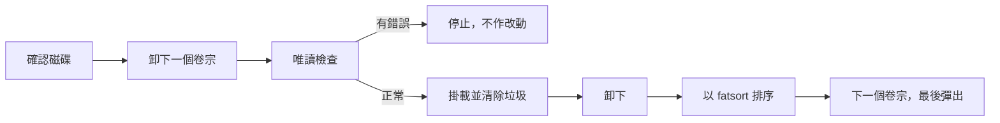

<div align="center">

<h1>katazuke</h1>

<strong>清除 macOS、Windows 和 NAS 在 FAT 或 exFAT 磁碟上留下的垃圾檔案，再為按磁碟次序列出檔案的裝置重新排列資料夾。</strong>

[English](README.md) | [日本語](README.ja.md) | [简体中文](README.zh-Hans.md) | 繁體中文 (香港)

[](https://github.com/gufranco/katazuke/actions/workflows/ci.yml)
[](https://github.com/gufranco/katazuke/releases/latest)
[](LICENSE)

<p align="center">
  <a href="#quick-start"><strong>快速開始</strong></a> |
  <a href="#what-it-removes">清除哪些檔案</a> |
  <a href="#development">開發</a>
</p>

</div>

一個指令，80 個測試，5 個 shell 模組，除 POSIX 系統外只需要 fatsort。`katazuke` 是日語的「片付け」，意思是收拾整理。它的姊妹工具 [kakikomi](https://github.com/gufranco/kakikomi) 負責寫入磁碟映像，[kiyome](https://github.com/gufranco/kiyome) 負責抹除磁碟。

---

```console
$ katazuke check /Volumes/EZFLASH
Volume: /dev/disk8, FAT32, EZFLASH
        /.fseventsd
        /._Mario Kart 10.gba
        /._Mario Kart 2.gba
        /._Metroid Fusion.gba
        /SAVER/Thumbs.db
        /SAVER/._Thumbs.db
        /._SAVER
Found 7 junk files on /dev/disk8. run katazuke /dev/disk8 to remove them.

$ katazuke /dev/disk8

Disk:   /dev/disk8, 63.0 MiB, DISK IMAGE
Volume: /dev/disk8, FAT32, EZFLASH
Plan:   remove junk files, then sort folders first in natural order
        then eject

Type disk8 to tidy, or anything else to stop: disk8
Removed 7 junk files from /dev/disk8 and sorted it.
Ejected. /dev/disk8 is safe to remove.
```

<a id="quick-start"></a>

## 快速開始

### 先決條件

| 工具 | 用途 | 安裝 |
|:-----|:-----|:-----|
| POSIX `sh`、`awk`、`sed`、`find` | 工具本身 | macOS 和 Linux 已預載。毋須 `bash` |
| `fatsort` | 按排序重寫每個資料夾。1.7 或以上版本可排序所有 exFAT 卷宗；Ubuntu 26.04 內置的 1.6.5 無法排序以 `mkfs.exfat` 格式化的卷宗 | `brew install fatsort`；`apt install fatsort` |
| `fsck_msdos`、`fsck_exfat` | 在 macOS 上於任何改動前作唯讀檢查 | 已預載 |
| `fsck.vfat`、`fsck.exfat` | 在 Linux 上作同樣的檢查 | `apt install dosfstools exfatprogs` |

### 安裝

```bash
brew install gufranco/tap/katazuke
```

亦可從原始碼安裝：

```bash
git clone https://github.com/gufranco/katazuke.git
cd katazuke
make install
```

`make install` 會把工具、man 說明頁，以及 bash、zsh 和 fish 的自動完成複製到 `~/.local`，並把 `katazuke` 放進 `~/.local/bin`；設定 `PREFIX` 可更改位置。Homebrew formula 會安裝同樣的檔案及 fatsort。

### 驗證

```console
$ katazuke doctor
fatsort            ok       /opt/homebrew/bin/fatsort
awk                ok       /opt/homebrew/opt/gawk/libexec/gnubin/awk, gnu 5.4.1
sed                ok       /opt/homebrew/opt/gnu-sed/libexec/gnubin/sed, gnu 4.10
find               ok       /usr/bin/find, bsd
sudo               ok       /usr/bin/sudo
diskutil           ok       /usr/sbin/diskutil
plutil             ok       /usr/bin/plutil
fsck_msdos         ok       /sbin/fsck_msdos
fsck_exfat         ok       /sbin/fsck_exfat
```

## 用法

| 指令 | 用途 |
|:-----|:-----|
| `katazuke [options] <device\|mount_point>` | 清除該磁碟上每個 FAT 和 exFAT 卷宗的垃圾，逐一排序，然後彈出磁碟 |
| `katazuke check <device\|mount_point>` | 列出每個卷宗上的垃圾，不作任何改動 |
| 不帶參數的 `katazuke` | 在終端機中執行時，詢問要處理的磁碟 |
| `katazuke doctor` | 列出 katazuke 需要的工具及是否已安裝 |
| `katazuke version`、`katazuke help` | 顯示版本或完整的用法說明 |

| 選項 | 作用 |
|:-----|:-----|
| `--natural`、`--no-natural` | 按數值排列數字，令 `Disc 2` 排在 `Disc 10` 之前。預設開啟 |
| `--order dirs\|files\|mixed` | 資料夾先、檔案先，或兩者混排。預設為 `dirs` |
| `--eject`、`--no-eject` | 完成後彈出磁碟。預設開啟 |
| `--allow-internal` | 容許內置磁碟。正在運行的系統所在的磁碟一律拒絕 |
| `--json` | 以一個 JSON 物件輸出結果，供腳本使用 |

亦可寫成 `--order=mixed`，`--` 表示選項結束。環境變數 `KATAZUKE_NATURAL`、`KATAZUKE_EJECT`、`KATAZUKE_ALLOW_INTERNAL` 和 `KATAZUKE_JSON` 取 `y` 或 `n`，`KATAZUKE_ORDER` 取相應的值，效果與選項相同；指令行上的選項優先。

```bash
katazuke /dev/disk4                     # 清理，資料夾先排序，然後彈出
katazuke /Volumes/EZFLASH               # 已掛載的卷宗代表它所在的整個磁碟
katazuke check /dev/sdb                 # 只列出垃圾，不作改動
katazuke --order mixed --no-eject /dev/disk4
```

磁碟可以用裝置名稱指定，例如 `/dev/disk4`，亦可用從它掛載的任何卷宗指定，例如 `/Volumes/USB`；katazuke 會找出卷宗背後的整個磁碟，並整理其中每個 FAT 和 exFAT 卷宗。

**指定單一分割區同樣代表整個磁碟。** `katazuke /dev/disk8s2` 會整理 `/dev/disk8` 上每個 FAT 和 exFAT 卷宗，而不只是第二個分割區。確認之前，摘要會列出每個卷宗，一次確認即適用於全部。磁碟上的其他檔案系統，例如 APFS 或 ext4，不會被改動。各卷宗按次序整理，若某個卷宗檢查失敗，流程即在該處停止：之前的卷宗保持已整理，之後的卷宗不受影響。

katazuke 遵從家族共用的指令行約定，內容見 [FAMILY.md](FAMILY.md)。

<a id="what-it-removes"></a>

## 清除哪些檔案

快閃記憶卡帶、遊戲載入器、MP3 播放器和汽車音響，往往按檔案在磁碟上的存放次序列出檔案。於是從 Mac 複製過來的資料夾裏，每個檔案都多了一個 `._` 孖生檔案；陸續加入內容的資料夾，則按寫入先後顯示項目。katazuke 清除前者，修正後者。

| 位置 | 名稱 |
|:-----|:-----|
| 只在卷宗的最頂層 | `System Volume Information`、`$RECYCLE.BIN`、`RECYCLER`、`RECYCLED`、`.Trashes`、`.Spotlight-V100`、`.fseventsd`、`.TemporaryItems`、`.DocumentRevisions-V100`、`.MobileBackups`、`.apdisk`、`.VolumeIcon.icns`、`.metadata_never_index`、`.com.apple.timemachine.*`、`Network Trash Folder`、`Temporary Items`、`TheFindByContentFolder`、`TheVolumeSettingsFolder`、`IndexerVolumeGuid`、`WPSettings.dat`、`FSCK*.REC`、`FOUND.000`、`.Trash-*`、`@eaDir`、`#recycle`、`@Recycle`、`.hotfiles.btree`、`.journal`、`.journal_info_block` |
| 每個資料夾 | `._*`、`.DS_Store`、`.AppleDouble`、`.AppleDB`、`.AppleDesktop`、`__MACOSX`、`Icon\r`、`Thumbs.db`、`ehthumbs.db`、`ehthumbs_vista.db`、`Desktop.ini`、`.directory`、`.~lock.*`、`~$*`、`.@__thumb`、`.dropbox`、`.dropbox.attr` |

卷宗頂層以下名為 `System Volume Information` 的資料夾是你的內容，因此會保留。`autorun.inf` 和 `DumpStack.log` 永不刪除，因為 DOS 或 Windows 遊戲碟可能需要它們。名稱比對不分大小寫。

<a id="how-it-works"></a>

## 運作原理



在作任何改動之前，每個卷宗都會先經檢查：macOS 上用 `fsck_msdos -n` 或 `fsck_exfat -n`，Linux 上用 `fsck.vfat -n` 或 `fsck.exfat -n`。在已損壞的檔案系統上重寫目錄可能令損壞擴大，所以檔案系統有錯誤的卷宗會令流程停止，且不作任何改動。

katazuke 從不寫入 `.fseventsd/no_log`：在 FAT 磁碟上它會留下四個新項目，而裝置顯示的正正是這些。在掛載狀態下清理再卸下，磁碟便會保持乾淨。

`check` 會以唯讀方式掛載未掛載的卷宗，因此 macOS 無法寫入，完成後再把它卸下。

自然排序按位元組比較名稱，所以以帶重音或非拉丁字母開頭的名稱，例如 `Ábaco` 或 `ゼルダ`，不會排在相鄰的 A 至 Z 名稱之間。在 macOS 上它們排在所有 A 至 Z 名稱之前；在 Linux arm64 上則排在之後。使用 `--no-natural` 時，它們在兩種系統上都排在所有 A 至 Z 名稱之後，而 `Disc 10` 會排在 `Disc 2` 之前。

<a id="portability"></a>

## 可攜性

全部以 POSIX `sh` 編寫，ShellCheck `-o all` 零警告。測試在 macOS 上於 `/bin/sh` 和 `dash`、系統內置的 bash 3.2 和 zsh、Homebrew 最新的 bash 和 zsh 下執行，在 Ubuntu 上於特權容器內的 `dash`、`bash`、`bash --posix` 和 `zsh` 下執行。

可在六種常用工具組合上運行：使用 GNU、uutils 或 BusyBox 工具的 Linux，以及使用系統內置工具、其較新的 Homebrew 版本或 Homebrew uutils 工具的 macOS。`katazuke doctor` 會列出 `awk`、`sed` 和 `find` 的種類與版本，例如 `gnu 4.10.0`、`uutils 0.8.0` 或 `bsd 20200816`，令問題報告寫明當時執行的是哪些工具。

<a id="development"></a>

## 開發

| 指令 | 說明 |
|:-----|:-----|
| `make fmt` | 以 shfmt 格式化所有腳本 |
| `make lint` | shfmt、對所有腳本、測試和自動完成執行 ShellCheck、名稱檢查，以及對 man 說明頁執行 mandoc |
| `make test` | 在系統 `sh` 下執行 `bats` 測試 |
| `make test-all` | 在每種 shell 下執行同樣的測試，macOS 上包括 bash 和 zsh 的兩個版本 |
| `make test-linux` | 在 Ubuntu 容器內執行同樣的測試 |
| `make coverage` | 合併本機與 Ubuntu 容器內的 bashcov 行覆蓋率，並執行與 CI 相同的 100% 門檻 |

測試會建立真實的 FAT12、FAT16、FAT32 和 exFAT 磁碟映像，以 `hdiutil` 或 `losetup` 連接，並實際作整理。CI 在 Ubuntu 和 macOS 上執行測試。推送到 `main` 而 CI 通過後，semantic-release 便會執行：`feat` 或 `fix` 提交會發佈新版本，更新 [`lib/core.sh`](lib/core.sh) 中的 `KATAZUKE_VERSION` 和 CHANGELOG，並更新 Homebrew formula。

## 授權

[MIT](LICENSE)
