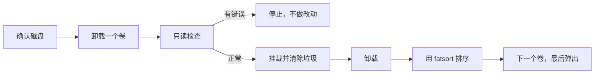
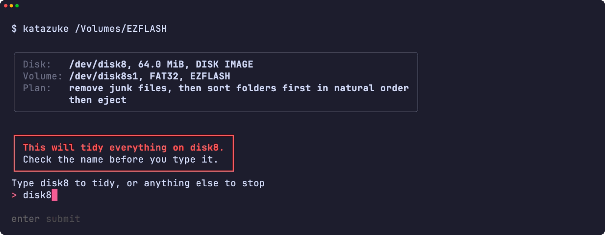
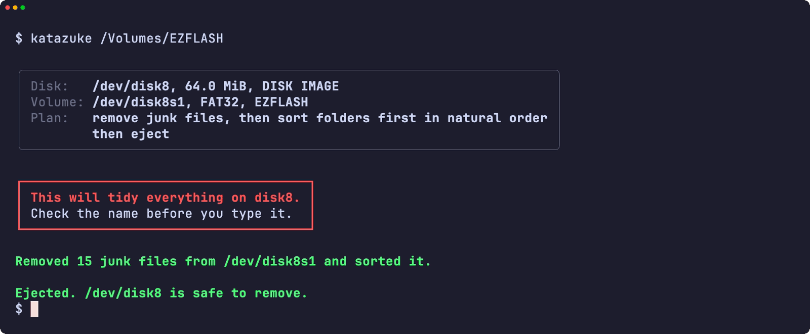
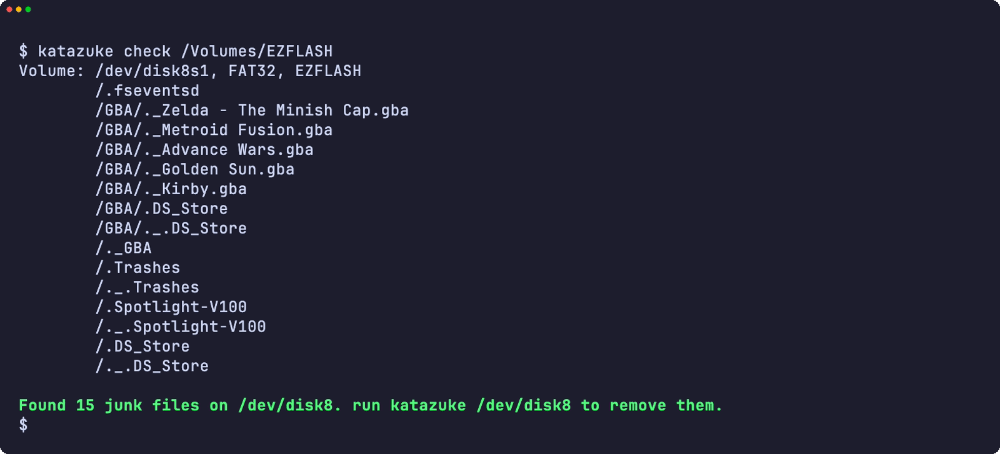
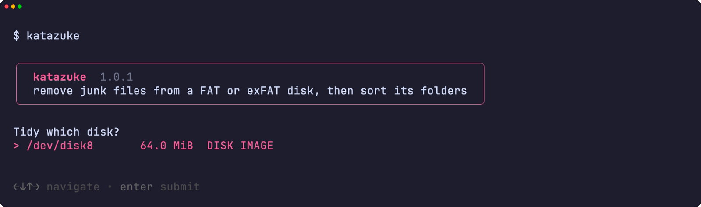
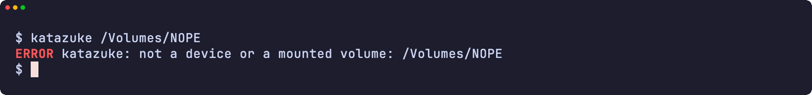
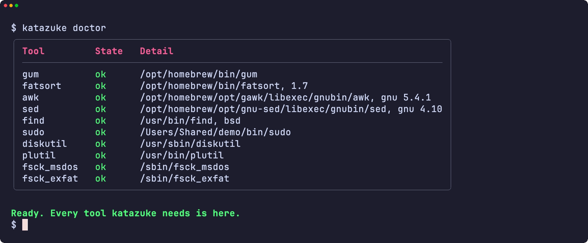
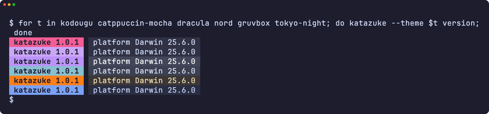
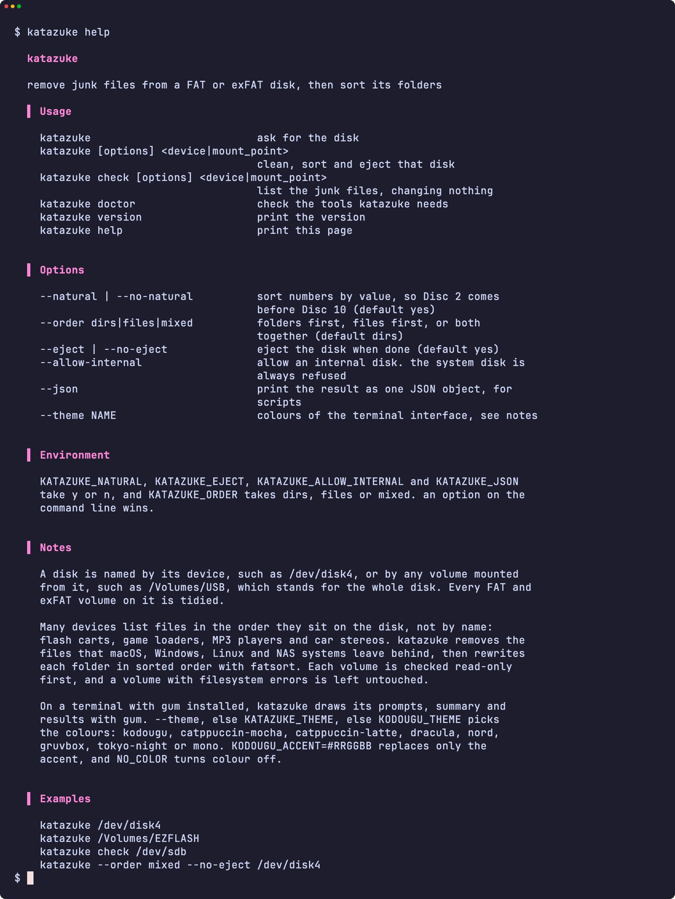

<div align="center">

<h1>katazuke</h1>

<strong>清除 macOS、Windows 和 NAS 在 FAT 或 exFAT 磁盘上留下的垃圾文件，再为按磁盘顺序列出文件的设备整理文件夹的排列顺序。</strong>

[English](README.md) | [日本語](README.ja.md) | 简体中文 | [繁體中文 (香港)](README.zh-HK.md)

[](https://github.com/gufranco/katazuke/actions/workflows/ci.yml)
[](https://github.com/gufranco/katazuke/releases/latest)
[](LICENSE)

<p align="center">
  <a href="#quick-start"><strong>快速开始</strong></a> |
  <a href="#what-it-removes">清除哪些文件</a> |
  <a href="#development">开发</a>
</p>

</div>

一个命令，149 个测试，6 个 shell 模块，除 POSIX 系统外只依赖 fatsort 和 gum。`katazuke` 是日语的「片付け」，意思是收拾整理。它的姊妹工具 [kakikomi](https://github.com/gufranco/kakikomi) 负责写入磁盘映像，[kiyome](https://github.com/gufranco/kiyome) 负责擦除磁盘。

---

<p align="center">
  
</p>

```console
$ katazuke check /Volumes/EZFLASH
Volume: /dev/disk8, FAT32, EZFLASH
        /.fseventsd
        /._Mario Kart 10.gba
        /._Mario Kart 2.gba
        /._Metroid Fusion.gba
        /SAVER/Thumbs.db
        /SAVER/._Thumbs.db
        /._SAVER
Found 7 junk files on /dev/disk8. run katazuke /dev/disk8 to remove them.

$ katazuke /dev/disk8

Disk:   /dev/disk8, 63.0 MiB, DISK IMAGE
Volume: /dev/disk8, FAT32, EZFLASH
Plan:   remove junk files, then sort folders first in natural order
        then eject

Type disk8 to tidy, or anything else to stop: disk8
Removed 7 junk files from /dev/disk8 and sorted it.
Ejected. /dev/disk8 is safe to remove.
```

<a id="quick-start"></a>

## 快速开始

### 前置条件

| 工具 | 用途 | 安装 |
|:-----|:-----|:-----|
| [`gum`](https://github.com/charmbracelet/gum) | 终端界面：菜单、输入、表格和配色 | `brew install gum`。Homebrew formula 会自动安装 |
| POSIX `sh`、`awk`、`sed`、`find` | 工具本身 | macOS 和 Linux 已预装。不需要 `bash` |
| `fatsort` | 按排序重写每个文件夹。1.7 及以上版本可排序所有 exFAT 卷；Ubuntu 26.04 自带的 1.6.5 无法排序用 `mkfs.exfat` 格式化的卷 | `brew install fatsort`；`apt install fatsort` |
| `fsck_msdos`、`fsck_exfat` | 在 macOS 上于任何改动前做只读检查 | 已预装 |
| `fsck.vfat`、`fsck.exfat` | 在 Linux 上做同样的检查 | `apt install dosfstools exfatprogs` |

### 安装

```bash
brew install gufranco/tap/katazuke
```

也可以从源码安装：

```bash
git clone https://github.com/gufranco/katazuke.git
cd katazuke
make install
```

`make install` 会把工具、man 手册以及 bash、zsh 和 fish 的补全复制到 `~/.local`，并把 `katazuke` 放进 `~/.local/bin`；设置 `PREFIX` 可以改变位置。Homebrew formula 安装同样的文件以及 fatsort。

### 验证

```console
$ katazuke doctor
gum                ok       /opt/homebrew/bin/gum
fatsort            ok       /opt/homebrew/bin/fatsort
awk                ok       /opt/homebrew/opt/gawk/libexec/gnubin/awk, gnu 5.4.1
sed                ok       /opt/homebrew/opt/gnu-sed/libexec/gnubin/sed, gnu 4.10
find               ok       /usr/bin/find, bsd
sudo               ok       /usr/bin/sudo
diskutil           ok       /usr/sbin/diskutil
plutil             ok       /usr/bin/plutil
fsck_msdos         ok       /sbin/fsck_msdos
fsck_exfat         ok       /sbin/fsck_exfat
```

## 用法

| 命令 | 用途 |
|:-----|:-----|
| `katazuke [options] <device\|mount_point>` | 清除该磁盘上每个 FAT 和 exFAT 卷的垃圾，逐一排序，然后弹出磁盘 |
| `katazuke check <device\|mount_point>` | 列出每个卷上的垃圾，不做任何改动 |
| 不带参数的 `katazuke` | 在终端中运行时询问要处理的磁盘 |
| `katazuke doctor` | 列出 katazuke 需要的工具以及是否已安装 |
| `katazuke version`、`katazuke help` | 显示版本或完整的用法说明 |

| 选项 | 作用 |
|:-----|:-----|
| `--natural`、`--no-natural` | 按数值排列数字，让 `Disc 2` 排在 `Disc 10` 前面。默认开启 |
| `--order dirs\|files\|mixed` | 文件夹在前、文件在前，或两者混排。默认为 `dirs` |
| `--eject`、`--no-eject` | 完成后弹出磁盘。默认开启 |
| `--allow-internal` | 允许内置磁盘。运行中系统所在的磁盘始终会被拒绝 |
| `--json` | 以一个 JSON 对象输出结果，供脚本使用 |
| `--theme <name>` | 终端界面的配色 |

也可以写成 `--order=mixed`，`--` 表示选项结束。环境变量 `KATAZUKE_NATURAL`、`KATAZUKE_EJECT`、`KATAZUKE_ALLOW_INTERNAL` 和 `KATAZUKE_JSON` 取 `y` 或 `n`，`KATAZUKE_ORDER` 取对应的值，效果与选项相同；命令行上的选项优先。

```bash
katazuke /dev/disk4                     # 清理，文件夹在前排序，然后弹出
katazuke /Volumes/EZFLASH               # 已挂载的卷代表它所在的整个磁盘
katazuke check /dev/sdb                 # 只列出垃圾，不做改动
katazuke --order mixed --no-eject /dev/disk4
```

磁盘可以用设备名指定，例如 `/dev/disk4`，也可以用从它挂载的任意卷指定，例如 `/Volumes/USB`；katazuke 会找出卷背后的整个磁盘，并整理其中每个 FAT 和 exFAT 卷。

**指定单个分区同样代表整个磁盘。** `katazuke /dev/disk8s2` 会整理 `/dev/disk8` 上的每个 FAT 和 exFAT 卷，而不只是第二个分区。确认之前，摘要会列出每个卷，一次确认即适用于全部。磁盘上的其他文件系统，例如 APFS 或 ext4，不会被改动。各卷按顺序整理，若某个卷检查失败，流程即在该处停止：之前的卷保持已整理，之后的卷不受影响。

katazuke 遵循家族共享的命令行约定，内容见 [FAMILY.md](FAMILY.md)。

### 主题

在装有 `gum` 的终端里，katazuke 用 gum 绘制菜单、输入、表格和消息；在管道或脚本中，输出仍是纯文本。配色依次由 `--theme`、`KATAZUKE_THEME`、`KODOUGU_THEME` 决定，最后一个由所有 kodougu 工具共用：`kodougu`（默认）、`catppuccin-mocha`、`catppuccin-latte`、`dracula`、`nord`、`gruvbox`、`tokyo-night` 或 `mono`。`KODOUGU_ACCENT=#RRGGBB` 只替换强调色，`NO_COLOR` 关闭颜色。

```bash
export KODOUGU_THEME=catppuccin-mocha
```

<a id="what-it-removes"></a>

## 清除哪些文件

闪存卡带、游戏加载器、MP3 播放器和车载音响常常按文件在磁盘上的存放顺序列出文件。于是从 Mac 复制过来的文件夹里，每个文件都多出一个 `._` 双胞胎；陆续添加内容的文件夹，则按写入的先后显示条目。katazuke 清除前者，修正后者。

| 位置 | 名称 |
|:-----|:-----|
| 只在卷的最顶层 | `System Volume Information`、`$RECYCLE.BIN`、`RECYCLER`、`RECYCLED`、`.Trashes`、`.Spotlight-V100`、`.fseventsd`、`.TemporaryItems`、`.DocumentRevisions-V100`、`.MobileBackups`、`.apdisk`、`.VolumeIcon.icns`、`.metadata_never_index`、`.com.apple.timemachine.*`、`Network Trash Folder`、`Temporary Items`、`TheFindByContentFolder`、`TheVolumeSettingsFolder`、`IndexerVolumeGuid`、`WPSettings.dat`、`FSCK*.REC`、`FOUND.000`、`.Trash-*`、`@eaDir`、`#recycle`、`@Recycle`、`.hotfiles.btree`、`.journal`、`.journal_info_block` |
| 每个文件夹 | `._*`、`.DS_Store`、`.AppleDouble`、`.AppleDB`、`.AppleDesktop`、`__MACOSX`、`Icon\r`、`Thumbs.db`、`ehthumbs.db`、`ehthumbs_vista.db`、`Desktop.ini`、`.directory`、`.~lock.*`、`~$*`、`.@__thumb`、`.dropbox`、`.dropbox.attr` |

卷顶层以下名为 `System Volume Information` 的文件夹是你的内容，因此会保留。`autorun.inf` 和 `DumpStack.log` 永远不会被删除，因为 DOS 或 Windows 游戏盘可能需要它们。名称匹配不区分大小写。

<a id="how-it-works"></a>

## 工作原理



在做任何改动之前，每个卷都会先经过检查：macOS 上用 `fsck_msdos -n` 或 `fsck_exfat -n`，Linux 上用 `fsck.vfat -n` 或 `fsck.exfat -n`。在已损坏的文件系统上重写目录可能让损坏扩大，所以文件系统有错误的卷会让流程停止，且不做任何改动。

katazuke 从不写入 `.fseventsd/no_log`：在 FAT 磁盘上它会留下四个新条目，而设备显示的正是这些。在挂载状态下清理再卸载，磁盘就会保持干净。

`check` 会以只读方式挂载未挂载的卷，因此 macOS 无法写入，完成后再将其卸载。

自然排序按字节比较名称，所以以带重音或非拉丁字母开头的名称，例如 `Ábaco` 或 `ゼルダ`，不会排在相邻的 A 到 Z 名称之间。在 macOS 上它们排在所有 A 到 Z 名称之前；在 Linux arm64 上则排在之后。使用 `--no-natural` 时，它们在两种系统上都排在所有 A 到 Z 名称之后，而 `Disc 10` 会排在 `Disc 2` 之前。

<a id="portability"></a>

## 可移植性

全部使用 POSIX `sh` 编写，ShellCheck `-o all` 零警告。测试在 macOS 上于 `/bin/sh` 和 `dash`、系统自带的 bash 3.2 和 zsh、Homebrew 最新的 bash 和 zsh 下运行，在 Ubuntu 上于特权容器中的 `dash`、`bash`、`bash --posix` 和 `zsh` 下运行。

可在六种常见工具集上运行：使用 GNU、uutils 或 BusyBox 工具的 Linux，以及使用系统自带工具、其较新的 Homebrew 版本或 Homebrew uutils 工具的 macOS。`katazuke doctor` 会写出 `awk`、`sed` 和 `find` 的种类与版本，例如 `gnu 4.10.0`、`uutils 0.8.0` 或 `bsd 20200816`，让问题报告说明当时运行的是哪些工具。

<a id="screens"></a>

## 界面

<details>
<summary>全部界面，均由 <code>make screens</code> 录自真实运行</summary>
<br>

<table>
<tr>
<td width="50%" valign="top"><br><sub>危险框下输入名称</sub></td>
<td width="50%" valign="top"><br><sub>结果</sub></td>
</tr>
<tr>
<td width="50%" valign="top"><br><sub>check 列出垃圾文件，不做任何更改</sub></td>
<td width="50%" valign="top"><br><sub>选择磁盘</sub></td>
</tr>
<tr>
<td width="50%" valign="top"><br><sub>错误</sub></td>
<td width="50%" valign="top"><br><sub>doctor 检查所需的每个工具</sub></td>
</tr>
<tr>
<td width="50%" valign="top"><br><sub>六种主题下的版本标记</sub></td>
<td width="50%" valign="top"><br><sub>帮助页</sub></td>
</tr>
</table>

</details>

<a id="development"></a>

## 开发

| 命令 | 说明 |
|:-----|:-----|
| `make fmt` | 用 shfmt 格式化所有脚本 |
| `make lint` | shfmt、对所有脚本、测试和补全运行 ShellCheck、名称检查，以及对 man 手册运行 mandoc |
| `make test` | 在系统 `sh` 下运行 `bats` 测试 |
| `make test-all` | 在每种 shell 下运行同样的测试，macOS 上包括 bash 和 zsh 的两个版本 |
| `make test-linux` | 在 Ubuntu 容器中运行同样的测试 |
| `make coverage` | 合并本机与 Ubuntu 容器中的 bashcov 行覆盖率，并执行与 CI 相同的 100% 门槛 |
| `make screens` | 在 macOS 上用 VHS 从真实工具录制 README 的界面 |

测试会创建真实的 FAT12、FAT16、FAT32 和 exFAT 磁盘映像，用 `hdiutil` 或 `losetup` 挂接，并实际进行整理。CI 在 Ubuntu 和 macOS 上运行测试。推送到 `main` 且 CI 通过后，semantic-release 会运行：`feat` 或 `fix` 提交会发布新版本，更新 [`lib/core.sh`](lib/core.sh) 中的 `KATAZUKE_VERSION` 和 CHANGELOG，并更新 Homebrew formula。

## 许可证

[MIT](LICENSE)
